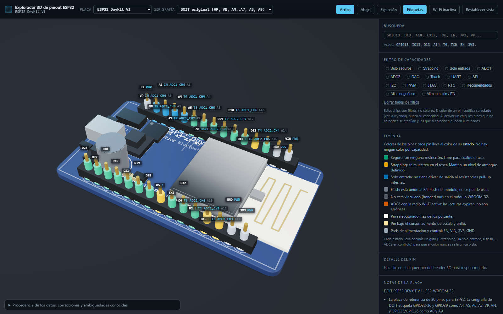

# ESP32 3D Pinout Explorer

An interactive **3D** pinout reference for the **ESP32 DevKit V1** and the
**ESP-32S / NodeMCU-32S**, built with vanilla JavaScript and Three.js.

Every exposed pin shows its complete, source-verified capability set, its restrictions, and a
plain-English explanation of why each restriction exists. The board is modelled procedurally:
there are no downloaded 3D models, no image files and no HDR environment maps, so the
repository installs and runs fully offline.



**UI language.** The user-facing interface — explanations, warnings, the pin panel, the legend,
the filter chips and the board notes — is in **Spanish**, with the technical terms and the
datasheet identifiers kept in English (`GPIO`, `ADC1`, `strapping`, `HSPIWP`, `VP`, `A18`,
`arduino-esp32`, ...). Code, comments, identifiers, CSS class names, data keys and this README stay
in English.

More screenshots, including the silkscreen read from above, a selected pin, the DAC filter, the
exploded view and the underside, are in [`docs/`](docs).

---

## Requirements

- Node.js 24 or newer
- npm 11 or newer

## Install, run, build

```bash
npm install       # installs three + vite, nothing else
npm run dev       # Vite dev server on http://localhost:5173
npm run build     # static production build into dist/
npm run preview   # serve the production build locally
```

The build output uses a relative `base`, so `dist/` can be served from any static path.

## What it does

| Control | Behaviour |
| --- | --- |
| **Board** | Switches between ESP32 DevKit V1 and ESP-32S with a cross-fade transition |
| **Silkscreen** | Switches between the original DOIT printing and the common clone printing, on the board and in the 3D labels |
| **Top / Bottom** | Straight-down view of the component side / turns the board over and looks straight down at the bare underside |
| **Explode** | Separates the components vertically with staggered easing |
| **Labels** | Shows or hides the 3D pin labels |
| **Wi-Fi on** | Flags every ADC2 pin as contested with the Wi-Fi radio |
| **Reset view** | Returns the camera to the default three-quarter view |
| **Filter chips** | Highlights matching pins and dims the rest |
| **Search** | `GPIO13`, `IO13`, `D13`, `A14`, `T4`, `TX0`, `EN`, `3V3`, `VP` and role fragments all resolve |
| Hover / click | Hover lifts and glows a pin; click opens the full information panel |
| Double-click | Frames a single pin with the camera |

Pins are colour-coded by state **and** carry a glyph (`!` strapping, `IN` input only, `X` flash,
`~` ADC2 contested, `PWR` power) so state never depends on hue alone. The palette is Okabe-Ito
based for colour-vision-deficiency safety.

### The three ADC2 states, precisely

The app does **not** say "ADC2 is broken". The ADC2 block is shared with the Wi-Fi radio, so
only one controller holds it at a time and the loser times out with `ESP_ERR_TIMEOUT` from
`adc2_get_raw()`. ADC1 is never affected by the radio. This is modelled as a **contested**
state, not a broken one.

---

## Architecture

Data is strictly separated from rendering. Adding a board is a pure data change.

```
index.html                 HUD skeleton
vite.config.js
src/
  main.js                  state owner; wires scene, data and UI together
  style.css
  data/
    gpio.js                all 34 WROOM-32 GPIOs: capabilities, restrictions, aliases, sources
    boards.js              board definitions, locked header order, silkscreen conventions
    peripherals.js         UART/SPI/I2C/I2S/PCNT/TWAI/RMT defaults, routing rules, traps
  three/
    scene.js               renderer, camera, controls, lights, IBL, render loop
    boardModel.js          procedural geometry + runtime silkscreen canvas textures
    pinMeshes.js           per-pin pickable meshes and the visual state machine
    labels.js              CSS2D label lifecycle
    animations.js          board switch, flip, explode, camera transitions
    palette.js             state and capability colours
    tween.js               small easing/tween helper (no extra dependency)
  interaction/
    raycast.js             pointer hover, click, double-click framing
    filters.js             capability filter and search state
  ui/
    hud.js                 selectors, toggles, filter chips, legend, provenance panel
    pinPanel.js            full per-pin information panel
    dom.js                 small DOM helpers
```

`src/three/scene.js` uses `RoomEnvironment` + `PMREMGenerator` for image-based lighting, so
there is no `.hdr` file to fetch.

### Header order (locked)

Left column, top to bottom:
`EN, VP(36), VN(39), 34, 35, 32, 33, 25, 26, 27, 14, 12, 13, GND, VIN`

Right column, top to bottom:
`23, 22, TX0(1), RX0(3), 21, 19, 18, 5, 17, 16, 4, 2, 15, GND, 3V3`

Count check: **25 GPIO + 3V3 + EN + VIN + 2 x GND = 30**.

`src/data/boards.js` exposes `validateDataset()`, which asserts these invariants and is called
in dev builds only.

---

## Data provenance

Everything is taken from primary Espressif sources:

- ESP32 Series Datasheet
- ESP32-WROOM-32 Datasheet v3.7
- ESP-IDF documentation: ADC, GPIO, DAC, `cap_touch_sens`
- ESP32-DevKitC V4 User Guide and schematic
- esptool boot-mode documentation (strapping)
- `arduino-esp32` `variants/esp32/pins_arduino.h`

Corroborating only: the DOIT DevKit V1 schematic silkscreen layer.

### Three corrections applied after verification

All three of the original pre-implementation assumptions were **wrong**:

1. **ADC1 is GPIO32–GPIO39 only** (8 channels). **ADC2 is GPIO0, 2, 4, 12, 13, 14, 15, 25, 26,
   27** (10 channels). The intuitive "ADC1 = even pins, ADC2 = odd pins" split is false.
2. **The ESP32 has exactly two DAC channels**: DAC1 = GPIO25, DAC2 = GPIO26. There is **no
   DAC3**, and **GPIO18 is not a DAC pin** — it is the default VSPI clock.
3. **GPIO34, 35, 36 and 39 have no touch function.** They are also input only and have no
   internal pull resistors. Touch CH0–CH9 = GPIO 4, 0, 2, 15, 13, 12, 14, 27, 33, 32.

Also resolved: GPIO20 does not exist on the ESP32-WROOM-32 (PICO-V3 package only), and
GPIO37/GPIO38 are not bonded out on the module.

### Known ambiguities, disclosed in-app rather than hidden

- **Column-to-physical-edge rotation.** The header *order* is locked by two agreeing sources,
  but which column sits on which physical edge of the PCB could not be machine-verified against
  a board photograph. The rotation shown is a rendering choice.
- **PCB size conflict.** Sources report 51.45 x 28.33, 51.8 x 28.2 and 53.3 x 25.0 mm. The model
  uses 51.6 x 28.4 mm.
- **GPIO0 is not broken out on the 30-pin header.** The BOOT button connects straight to the
  module pad. GPIO0 is still modelled and badged as not exposed, because it is a real and
  important strapping pin and users need to know about it. It is reachable from the search box.
- **"ESP-32S" is not an Espressif board name** and has no authoritative documentation. It is a
  market name for boards functionally identical to the DOIT DevKit V1, so it is rendered as a
  **cosmetic skin over the shared pin dataset** (PCB colour, silkscreen convention, USB-UART
  chip label). **No electrical difference is claimed or invented.**
- **Module and USB edge orientation** in the 3D model is a rendering approximation; the
  photographic reference could not be verified programmatically.
- **Underside silkscreen content is an approximation.** The orientation is exact (the printing
  reads correctly when the underside is viewed with the USB on the left), but the real underside
  printing differs between manufacturers and revisions and could not be verified
  against a board photograph. The **Abajo** button turns the board over and looks straight down at
  the bare underside, so the pads, the antenna keep-out and that printing are all reachable from the
  UI.
- **Arduino alias trap.** `A11` = GPIO0, `A12` = GPIO2, `A13` = GPIO15 and `A15` = GPIO12 are
  strapping pins whose alias is a trap. The original DOIT silkscreen additionally prints GPIO25
  and GPIO26 as `A8` and `A9`, while the arduino-esp32 core defines them as `A18` and `A19`.
  `A1`, `A2`, `A8` and `A9` are not offered as Arduino aliases in this app.

### Other documented traps surfaced in the UI

- UART1 defaults to GPIO9/GPIO10, both SPI-flash pads, so `Serial1` cannot receive on a WROOM-32.
- HSPI uses GPIO14, 12, 13, 15 — all strapping or JTAG pins.
- On the ESP32 **any GPIO can be SDA or SCL**. The "SDA must come from a PWM/LEDC source" rule
  is an **ESP32-S2/C3** limitation and is deliberately **not** shown for the ESP32.
- I2S has no Espressif default pin map. Any published ESP32 I2S pinout is a community
  convention, and it is labelled as such.
- GPIO36 and GPIO39 can show an ~80 ns glitch when the SARADC or Hall power switches;
  `adc_power_acquire()` / `adc_power_release()` around the sample suppresses it.
- Internal pull resistors are about 45 kΩ, and GPIO34–39 have none at all.

---

## Verification performed

- `npm install` and `npm run build` complete with zero errors.
- `npm run verify:data` runs 95 structural assertions against the source-verified dataset (ADC
  maps, the two-DAC rule, the touch map, the strapping set with both boot states, the MTDI/MTDO
  exclusivity in both the strapping role and the JTAG pad list, the nonexistent vs not-bonded-out
  distinction, the header order and rail set, the Arduino alias set, the peripheral default maps).
  The prose guards assert structure and language-independent tokens, not English wording, so the
  Spanish UI does not weaken them.
- `validateDataset()` returns an empty problem list: 15 entries per column, 30 total,
  25 GPIO + 3V3 + EN + VIN + 2 x GND, no duplicates.
- A real headless Chrome run (Playwright, real GPU WebGL) against the production build asserts 45
  DOM, viewport, camera and geometry conditions, **0 console errors, 0 uncaught exceptions**, at
  three viewports: 1600x1000, 1024x769 and 1025x769 at `devicePixelRatio` 1.5. Among them:
  - the canvas CSS box equals its client rect and the host rect, and the drawing buffer is exactly
    `round(css * devicePixelRatio)` — 1028x1064 for a 685x709 CSS box at DPR 1.5;
  - **Top** puts the camera 0.6 degrees off vertical with a margin of at least 48 px on every edge,
    and **Bottom** turns the board over and looks down at the bare underside, also 0.6 degrees off
    vertical; after a real resize to a 1400x420 viewport the margin is still 14 px and the viewing
    angle is unchanged;
  - the WROOM-32 carrier does not overhang the PCB: -0.16 mm measured from the world bounding
    boxes, and 1 px in a rendered straight-down frame, while still measuring 25.5 x 18.0 mm;
  - for **every** capability filter the number of rendered labels equals the number of matched
    header positions, because a pin the filter matched is never hidden by the declutter;
  - the panel shows the datasheet literals `ADC2_CH8` (GPIO25), `HSPIWP` (GPIO2), `VSPICS0`
    (GPIO5), `MTDO` (GPIO15), `MTDI` (GPIO12) and `MTCK` (GPIO13);
  - the selection beam is a narrow soft glow, not a filled column;
  - no capability chip carries a colour swatch, and the legend says pin colour means state;
  - the ESP-32S applies its own default silkscreen convention; the Labels toggle hides every label
    including the selected one; `data-silk` tracks the convention; no two labels overlap in the
    unfiltered view; the label layer never goes stale across a board switch.
- Note: because labels are decluttered, the DOM does not hold exactly 30 `.pin-label` elements
  at all times. A label hidden by the declutter is not in the layer, so the assertions are
  "no overlapping visible labels" and "never more than 30 elements" instead.
- Screenshots and the per-pass findings are in [`docs/`](docs) and in
  `odd/tasks/esp32-pinout-3d.md`.

## Adding a board

Append an entry to `BOARDS` in `src/data/boards.js` and, if its header differs, supply your own
`HEADER_LEFT` / `HEADER_RIGHT` arrays. The renderer, filters, labels, search and information
panel all read from those data structures. No rendering code needs to change.
